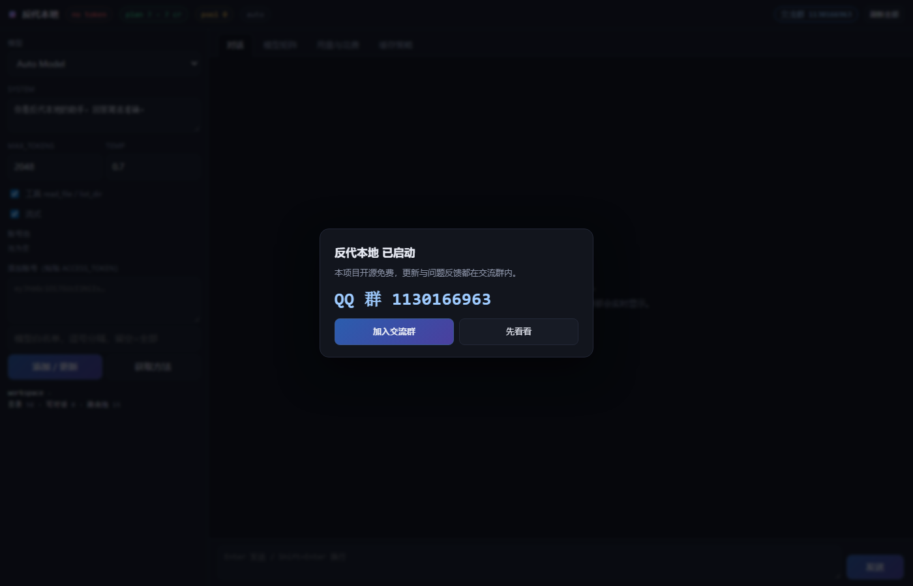

# 反代本地 · cvg-bridge

把 **Converge / enter.pro** 的模型反代成本地 **OpenAI / Anthropic 兼容**服务，供 [opencode](https://github.com/sst/opencode)、任意 OpenAI SDK 或内置网页直接调用。

零依赖（Node 18+），支持**多账号池自动切号**、**prompt cache**、**工具调用**、**流式平滑输出**、**单页控制台**。

<p align="center">
  
</p>

> 交流群：**1130166963** · 加群链接 <https://qm.qq.com/q/NBX5cnLfIC>

---

## English

**cvg-bridge** exposes **Converge / enter.pro** models as local **OpenAI- and Anthropic-compatible** APIs, so you can use them from [opencode](https://github.com/sst/opencode), any OpenAI SDK, or the built-in web console.

Zero dependencies (Node 18+). Multi-account pooling with automatic failover, prompt caching, tool calling, smoothed streaming, and a single-page console.

### Features

- **OpenAI compatible** — `/v1/chat/completions` with streaming and `tool_calls`
- **Anthropic native** — `/v1/messages` keeping `cache_control` breakpoints (up to 100% cache hit on Claude)
- **Account pool** — deduplicated by `sub`, per-account model allowlist, automatic rotation on 401 / quota errors, retrying the same request
- **Prompt cache** — stable `prompt_cache_key` (sha256 of model + system + tools) for OpenAI-family models, automatic `cache_control` breakpoints for Claude, implicit prefix caching for Gemini
- **Smoothed streaming** — re-chunks buffered upstream responses into 4 chars / 22 ms so output appears incrementally
- **Web console** — chat, tool calls, model matrix, usage & spend, cache policy, account management in one page
- **Usage ledger** — prompt / cached / completion / estimated credits per call, persisted to `usage.jsonl`

### Quick start

```bash
git clone https://github.com/999AAAXXX/cvg-bridge.git
cd cvg-bridge
node server.js
# open http://127.0.0.1:8097/
```

On Windows just double-click `一键启动.cmd` — it checks Node, starts the server, opens the console and the community group link.

### Add an account

Open the logged-in site, press F12 → Console:

```js
(async()=>{const j=await(await fetch('/auth/session?include=access_token')).json();
const r=await fetch('http://127.0.0.1:8097/ingest-token',{method:'POST',
  headers:{'Content-Type':'application/json'},body:JSON.stringify({token:j.accessToken})});
console.log('PUSH',r.status,await r.text())})()
```

Optionally pass a model allowlist: `{"token":"...","models":["gpt-6.1-sol"]}`.

### opencode

Merge the `provider` block from `opencode.converge.example.json` into `~/.config/opencode/opencode.json`, then:

```bash
opencode models | findstr converge
opencode -m converge/gpt-6.1-sol
```

### Endpoints

`GET /v1/models`, `POST /v1/chat/completions`, `POST /v1/messages`, `POST /v1/responses`,
`GET /api/status`, `GET /api/accounts`, `POST /api/switch`, `POST /api/account/update`,
`POST /api/remove`, `GET /api/credits`, `GET /api/usage`, `GET /api/cache-report`,
`POST /api/probe`, `POST /exec-tool`, `POST /ingest-token`.

Full parameter reference and troubleshooting: see the Chinese sections above.

### Token renewal

Access tokens last ~24 h. With a cookie export (`appSession`, `converge_session`):

```bash
python renew-cookie.py --file cookies.json --headed --push
```

Do **not** override the User-Agent — the default UA is what passes Cloudflare.

### Community

QQ group **1130166963** · <https://qm.qq.com/q/NBX5cnLfIC>

### License

MIT

---

## 特性

| 能力 | 说明 |
|---|---|
| OpenAI 兼容 | `/v1/chat/completions`，流式与 `tool_calls` 完整支持 |
| Anthropic 原生 | `/v1/messages`，保留 `cache_control` 断点，Claude 缓存命中率可到 100% |
| 多账号池 | 按 `sub` 去重，账号级模型白名单，额度耗尽 / 401 自动切号并重试同一请求 |
| 缓存 | OpenAI 系注入稳定 `prompt_cache_key`（sha256(model+system+tools)），Claude 自动打 `cache_control` 断点，Gemini 走隐式前缀 |
| 平滑流 | 上游整段返回时重切成 4 字 / 22ms，避免"唰一下全出" |
| 单页控制台 | 对话、工具调用、模型矩阵、用量与花费、缓存策略、账号池增删改切，全在一页 |
| 用量台账 | 每次调用记录 prompt / cached / completion / 估算 credits，持久化到 `usage.jsonl` |
| 零依赖 | 只用 Node 内置模块，`node server.js` 即可跑 |

## 快速开始

```bash
git clone <this-repo> cvg-bridge && cd cvg-bridge
node server.js
# 浏览器打开 http://127.0.0.1:8097/
```

Windows 用户双击 **一键启动.cmd**：自动检查 Node、启动服务、打开控制台和群链接。

### 添加账号

在已登录的站点页面按 `F12` → Console：

```js
(async()=>{const j=await(await fetch('/auth/session?include=access_token')).json();
const r=await fetch('http://127.0.0.1:8097/ingest-token',{method:'POST',
  headers:{'Content-Type':'application/json'},body:JSON.stringify({token:j.accessToken})});
console.log('PUSH',r.status,await r.text())})()
```

也可以在控制台左栏直接粘贴 token；可选填模型白名单（如 `gpt-6.1-sol`）。

## opencode 接入

把 `opencode.converge.example.json` 里的 `provider` 合并进 `~/.config/opencode/opencode.json`：

```bash
opencode models | findstr converge
opencode -m converge/gpt-6.1-sol
```

## 接口

| 方法 | 路径 | 说明 |
|---|---|---|
| GET | `/` | 单页控制台 |
| GET | `/v1/models` | 模型列表 |
| POST | `/v1/chat/completions` | OpenAI 兼容 |
| POST | `/v1/messages` | Anthropic 原生 |
| POST | `/v1/responses` | OpenAI Responses 透传 |
| GET | `/healthz` | 健康检查 |
| GET | `/api/status` | 鉴权 / 套餐 / 积分 / 模型矩阵 |
| GET | `/api/accounts` | 账号池（`?refresh=1` 刷新积分） |
| POST | `/api/switch` | 切换当前账号 `{"idx":1}` |
| POST | `/api/account/update` | 修改白名单 `{"idx":1,"models":["gpt-6.1-sol"]}` |
| POST | `/api/remove` | 移除账号 `{"idx":0}` |
| GET | `/api/credits` | 积分明细（breakdown / 阈值 / 欠费） |
| GET | `/api/usage` | 用量台账 |
| GET | `/api/cache-report` | 缓存机制与实测命中率 |
| POST | `/api/probe` | 模型探活（默认读 24h 缓存） |
| POST | `/exec-tool` | 页面工具执行（沙箱在 `toolRoot`） |
| POST | `/ingest-token` | 推送 token 入池 |

## 配置

```json
{
  "port": 8097,
  "gateway": "https://api.enter.pro/code/api/v1",
  "cache": { "enabled": true, "retention": "24h", "anthropicBreakpoints": true },
  "stream": { "smooth": true, "chunkChars": 4, "tickMs": 22 },
  "pool": { "tryAnyway": true },
  "probe": { "ttlHours": 24 },
  "toolRoot": "./"
}
```

| 字段 | 作用 |
|---|---|
| `cache.enabled` | 全模型缓存开关 |
| `stream.smooth` | 上游整段返回时重切小块；`false` 则原样透传 |
| `pool.tryAnyway` | 所有账号额度低时仍挑最高的硬打一次，透出上游真实报错 |
| `probe.ttlHours` | 探活结果缓存时长，避免反复花积分 |
| `toolRoot` | 页面 `read_file` / `list_dir` 沙箱根目录 |

## 缓存原理

```
key = sha256(model + system 消息 + tools 定义)   // 不含时间戳、不含对话历史
```

- **OpenAI 系**（gpt / kimi / qwen / glm / deepseek / minimax）：上游自动前缀缓存，桥补 `prompt_cache_retention: 24h`，Responses 协议补 `store: true`
- **Claude 系**：必须显式 `cache_control`，桥自动给 system 末块、最后一个 tool、长 user 消息打断点；被拒时自动剥离重试
- **Gemini**：隐式缓存，只保证前缀稳定

实测：同一前缀第二轮 Claude 命中 4348/4348 tokens，MiniMax 命中 2813/2814。

## token 续期

token 约 24 小时过期。准备账号的 cookie 导出文件（含 `appSession`、`converge_session`）后：

```bash
python renew-cookie.py --file cookies.json --headed --push
```

要点：

- **不要覆盖 User-Agent**，默认 UA 才能通过 Cloudflare
- `cf_clearance` 只有约 30 分钟寿命，注入时自动忽略，由浏览器重新签发
- `--headed` 打开真实窗口，Cloudflare challenge 自动通过

## 常见问题

| 报错 | 处理 |
|---|---|
| `401 Token not found` | 没带 Authorization 头（网关不认 cookie） |
| `401 Failed to validate JWT` | token 过期，重新续期 |
| `402 insufficient credits` | 积分低于阈值，换号或充值 |
| `400 X-Workspace-ID header is required` | 桥会自动探测，检查 `/workspaces` 是否可访问 |
| `500 no healthy routes available` | 该账号无此模型权限 |
| `403 you are not a member of this workspace` | 多号时工作区不匹配，重启桥 |
| Cloudflare `Just a moment...` | 不要覆盖 UA，改用 `--headed` |

## 目录

```
server.js                        服务本体（零依赖）
ui.html                          单页控制台
config.json                      配置
auth.js                          命令行鉴权助手
一键启动.cmd / 续期.cmd            Windows 入口
renew-cookie.py                  cookie 注入续期
renew.py / renew-daemon.py       登录态续期 / 常驻守护
models_capability.json           模型价格与协议快照
opencode.converge.example.json   opencode provider 片段
accounts.json / jwt.txt / usage.jsonl   运行时生成（含凭证，勿外传）
```

## 安全

本仓库**不含任何账号、token、cookie、邮箱**。运行时会生成 `accounts.json` / `jwt.txt` / `usage.jsonl`，已在 `.gitignore` 中忽略。详见 [SECURITY.md](SECURITY.md)。

## License

[MIT](LICENSE)
